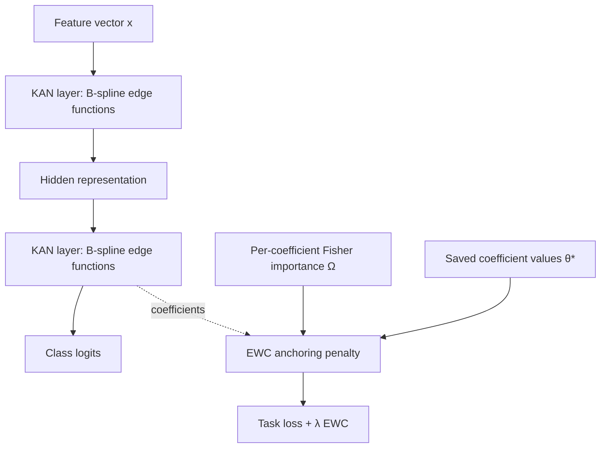
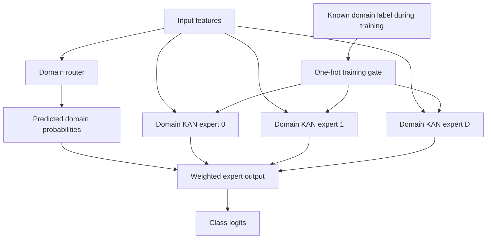
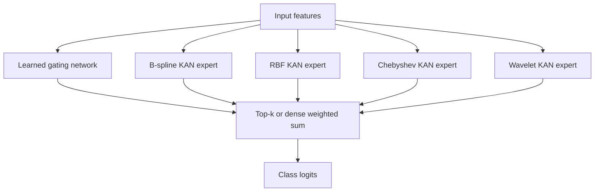
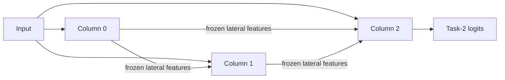
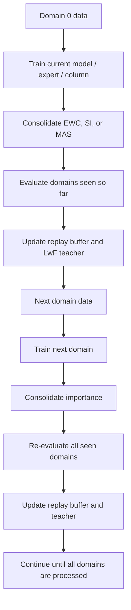

# Architecture and training flow

## Model family overview

### Protected-Spline KAN

Every KAN edge has a trainable coefficient vector over local basis functions. The default `OnlineEWC` filter selects parameter names containing `coefficients`, which means the penalty is element-wise across edge coefficients/knot values. The Fisher estimate is a minibatch-gradient approximation.

### Adaptive-Router KAN

During training, the known domain ID selects the corresponding expert while an auxiliary cross-entropy objective trains the router. During inference, the expert outputs are mixed using the router's predicted probabilities. This is domain-ID-free at test time only for domains already represented by the router.

### Hybrid-Basis MoE KAN

Use `top_k` to make routing sparse. The load-balancing term discourages expert collapse. The optional diversity term discourages highly correlated expert outputs; tune it cautiously because forced diversity can also hurt task performance.

### Progressive KAN baseline

Earlier columns are frozen when a new task/domain column is appended. This is a task-aware comparison baseline: provide `task_id` at evaluation. It is not a domain-agnostic method.

## Sequential training loop

At each stage, the evaluator records `A[t, d]`, the score on domain `d` after training through domain `t`. The final report derives average accuracy, forgetting, backward transfer, and first-domain retention from this matrix.

## Core implementation boundaries

- `models/basis.py`: registered basis implementations.
- `models/layers.py`: edge-wise `KANLinear`, sequential `KANNetwork`, MLP baseline.
- `models/architectures.py`: protected, adaptive-router, hybrid-MoE, progressive, FastKAN, and KAC-style models.
- `models/vision.py`: CNN feature encoder, KAN vision wrappers, conventional CNN baseline.
- `continual/regularization.py`: EWC, SI, MAS, and LwF loss.
- `continual/replay.py`: reservoir replay memory including source domain IDs.
- `continual/metrics.py`: accuracy matrix and continual-learning metrics.
- `data/`: synthetic domain generator and generic image-folder reader.
- `engine/`: registries, builders, experiment runner, trainer, and checkpointing.
